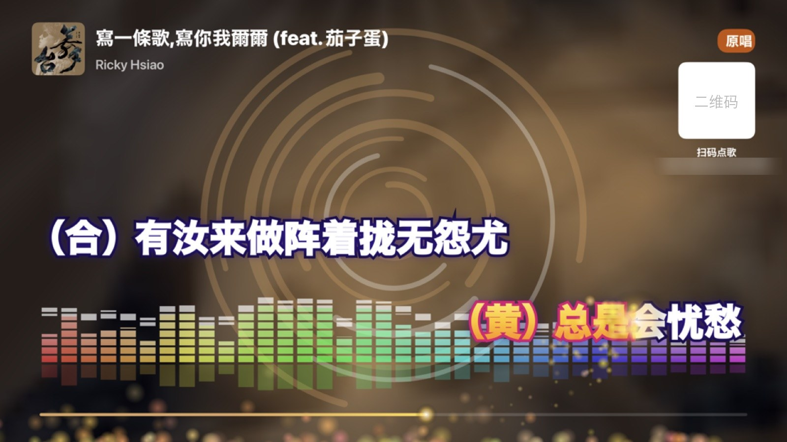
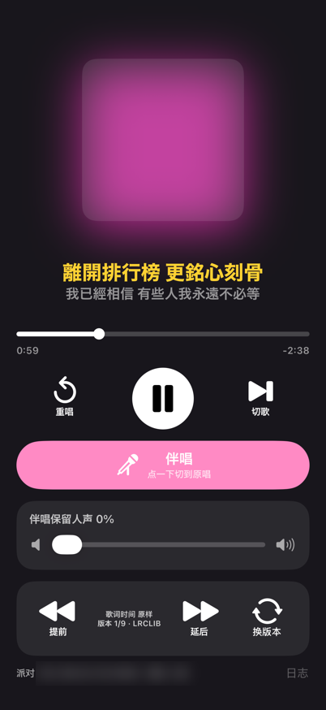

# MRProbe — a home karaoke room with an iPhone and a TV

[中文](README.md)

Connect an iPhone to a TV with HDMI and you have a karaoke (KTV) room:

- **Apple Music plays the song.** One tap on the phone switches between **original** and **backing track**, and a slider sets how much of the singer's voice stays (0–100).
- **Scrolling lyrics on the TV**: two alternating lines, colour that fills in word by word, the album cover as the background, and a background pulse when each line starts.
- **Party mode**: friends on the same Wi-Fi scan the QR code on the TV and use Safari to pick songs, queue them, move one to the front, take one back or skip. They can also send emoji, scrolling comments and fireworks to the TV. No app to install, no sign-in.
- **Suggestions**: what the host plays most, tonight's most picked, the charts, and what you picked before.

<table><tr>
<td width="30%"></td>
<td> 
Left: the phone is the console. One tap for original or backing track, a slider for how much voice to keep, and lyrics can be moved earlier or later or switched to another version. 
Right: party mode. The top left of the TV shows the next songs and who picked them. Friends' comments and emoji fly across the TV. Scan the code at the top right to pick songs.</td>
</tr></table>

The app, the TV screen and the guests' song page follow the phone language: Chinese for Chinese, English for everything else.

## Why it is not on the App Store

Original/backing track and the vocal level use a **private iOS framework, MediaRemote** (`MRMediaRemoteSendCommand`, command 142 `VocalsControl`), loaded with `dlopen` in `main.m`. Apple does not publish this interface and App Review would reject it, so only the source is here: build it with Xcode and install it on your own phone. Any iOS update can break it (tested working on iOS 27.2).

Everything else uses public APIs: MediaPlayer to play songs, MusicKit to search the catalog, UIScene for the external screen, Network.framework for the local HTTP server.

## What you need

- An iPhone on iOS 26 or later with an Apple Music subscription. Vocal control only works on songs that support Apple Music Sing (the microphone button in Music).
- A USB-C to HDMI cable and a TV. I use this one: [SWITCHFLUX USB-C to HDMI 2.0, 1.8 m](https://link.amazon/B0dr7LDOr). **AirPlay does not work**: when mirroring, the phone's screen covers the TV picture.
- A Mac with Xcode 26. Song search and suggestions use MusicKit, which needs the MusicKit service turned on for your App ID in the developer portal (paid developer account). A free account can install the app, but those features may not work.

## Build and install

1. Open `MRProbe.xcodeproj`.
2. Target → Signing & Capabilities: choose your own Team and change the Bundle Identifier `com.example.mrprobe` to your own.
3. Choose your iPhone and Run.

You can also change `DEVELOPMENT_TEAM` and the bundle id in `project.yml` and run [XcodeGen](https://github.com/yonaskolb/XcodeGen) (`xcodegen`) to make the project again.

## How to play

1. Connect the phone to HDMI and open MRProbe. The first time, it asks for Apple Music and local network access. Allow both.
2. Play a song in Music and MRProbe follows whatever is playing. You can also scan the code yourself and search and queue songs from the song page.
3. Friends scan the QR code in the corner of the TV (`http://<phone IP>:8080`) to open the song page.

## Known limits

- **The app must stay in the foreground.** If it goes to the background the song-picking server stops. It comes back when the app is in front again.
- Lyrics come only from [LRCLIB](https://lrclib.net), not from Apple (Apple's lyrics are not available to apps). LRCLIB is missing many Chinese songs; my own build adds a second, China-based lyrics source to fill the gaps, which is left out of this public version — add one yourself if you want, at your own risk.
  Some songs are missing and some timings are off. You can move the lyrics earlier or later for each song, and the app remembers it. For Cantonese and Mandarin versions of a song, the app picks the lyrics by the characters they use.
- Lyrics for the next song load in advance, but the first song, or a song you jump to, takes a few seconds.
- The catalog and charts follow the region of your Apple ID.
- No microphone: I tried the phone's microphone, the delay was too long, so it is gone.

## Files

| File | What it is |
| --- | --- |
| `main.m` | The whole app: playback, MediaRemote, lyrics, TV screen, phone console, party server |
| `party.html` | The song page on friends' phones |
| `Catalog.swift` | MusicKit search of the Apple Music catalog (this API is Swift only) |
| `project.yml` | XcodeGen project description |

## How it was made

Everything from the first line of code to party mode was written in conversation with [Claude Code](https://claude.com/claude-code): first a small test app to see if MediaRemote could change the vocals, then, once it could, lyrics, the TV screen and party song picking, one round at a time. Each step was installed on a real phone and tried — listening, watching the TV, reading the logs — before the next round of feedback.

## Disclaimer

A personal toy project, not connected with Apple or LRCLIB. The repository has no lyrics and no Apple code; lyrics are looked up from a third party when the app runs. It uses a private API: use it at your own risk.

The code is released under the [MIT](LICENSE) license.
