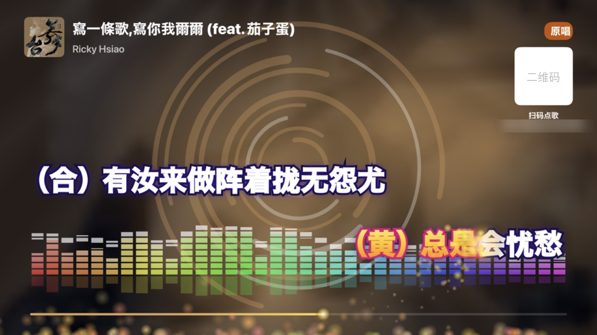
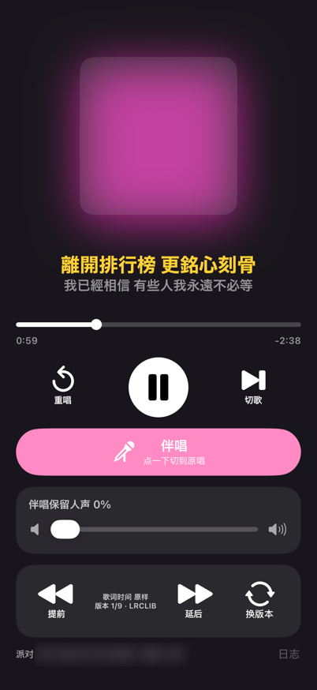

# MRProbe — 用 iPhone + 电视在家开 KTV

一台 iPhone 用 HDMI 接电视，就是一间 KTV：

- **Apple Music 放歌**，手机上一键 **原唱 / 伴唱**，还能拖动人声大小（0–100）。
- **电视上滚动歌词**：两行交替、逐字擦色、专辑封面做背景、歌词起句时背景跟着跳。
- **派对模式**：同一个 Wi-Fi 的朋友扫电视上的二维码，用 Safari 点歌、排队、优先、撤回、切歌，
  还能往电视上发 emoji、弹幕、烟花。不用装 app，不用登录。
- **推荐栏**：主人常听、今晚热门、排行榜、你点过的。

<table><tr>
<td width="30%"></td>
<td> 
左：手机是控制台，一键原唱/伴唱，拖动保留多少人声，歌词能提前/延后、换版本。 
右：派对模式，电视左上角是接下来的歌和谁点的，朋友发的弹幕和 emoji 直接飘在电视上，右上角扫码点歌。</td>
</tr></table>

English: an iPhone KTV (karaoke) app. Apple Music plays the song, the app turns the vocals down through
Apple Music Sing, shows timed lyrics on an HDMI TV, and lets guests on the same Wi-Fi queue songs from Safari.

## 为什么不上 App Store

原唱/伴唱和人声大小走的是 iOS 的**私有框架 MediaRemote**（`MRMediaRemoteSendCommand`，命令 142
`VocalsControl`），在 `main.m` 里用 `dlopen` 加载。苹果没有公开这个接口，审核不会通过，所以只放源码，
想玩的自己用 Xcode 装到自己手机上。iOS 更新随时可能让它失效（在 iOS 27.2 上测过可用）。

其他部分都是公开 API：MediaPlayer 放歌、MusicKit 查曲库、UIScene 外接屏幕、Network.framework 起本地 HTTP 服务。

## 需要什么

- iPhone，iOS 26 以上，订阅了 Apple Music。人声调节只对支持 Apple Music Sing（唱 K 麦克风按钮）的歌有效。
- USB-C 转 HDMI 线和一台电视。我用的是这根：[SWITCHFLUX USB-C to HDMI 2.0，1.8 米](https://link.amazon/B0dr7LDOr)。**AirPlay 不行**：镜像时外接屏幕的画面会被手机界面盖掉。
- Mac + Xcode 26。搜歌、推荐栏用的是 MusicKit，需要在开发者后台给 App ID 打开 MusicKit 服务（付费开发者账号）；免费账号能装，但这些功能可能用不了。

## 编译安装

1. 打开 `MRProbe.xcodeproj`。
2. Target → Signing & Capabilities：选你自己的 Team，把 Bundle Identifier `com.example.mrprobe` 改成你自己的。
3. 选你的 iPhone，Run。

也可以改 `project.yml` 里的 `DEVELOPMENT_TEAM` 和 bundle id，再用 [XcodeGen](https://github.com/yonaskolb/XcodeGen)
跑 `xcodegen` 重新生成工程。

## 怎么玩

1. 手机接上 HDMI，打开 MRProbe，第一次会问 Apple Music 和本地网络权限，都要允许。
2. 在“音乐”里放歌，MRProbe 会跟着当前播放的歌走；也可以自己扫码，用点歌页搜歌排队。
3. 朋友扫电视角落的二维码（`http://<手机IP>:8080`）进点歌页。

## 已知限制

- **app 必须在前台**。切到后台后点歌服务器会停，回到前台就恢复。
- 歌词只来自 [LRCLIB](https://lrclib.net)，不是苹果的（苹果歌词拿不到）。LRCLIB 缺不少中文歌；我自己的版本另外接了一个国内歌词源补缺，公开版拿掉了，想加的话自己加，风险自担。
  有的歌没有，有的时间轴不准；每首歌可以单独调提前/延后，会记住。粤语/国语版本按用字挑。
- 下一首的歌词会提前加载，但第一首或临时切的歌要等几秒。
- 曲库和排行榜跟着你 Apple ID 的地区走。
- 没有麦克风功能：试过用手机麦克风，延迟太大，删了。

## 文件

| 文件 | 内容 |
| --- | --- |
| `main.m` | 整个 app：播放控制、MediaRemote、歌词、电视画面、手机控制台、派对服务器 |
| `party.html` | 朋友手机上的点歌页 |
| `Catalog.swift` | MusicKit 查 Apple Music 曲库（这个 API 只有 Swift 版） |
| `project.yml` | XcodeGen 工程描述 |
| `PROMPTS.md` | 做这个 app 时我发给 Claude 的全部原话 |

## 怎么做出来的

从第一行代码到派对模式，全部是在 [Claude Code](https://claude.com/claude-code) 里聊出来的：
先写一个小测试 app 探 MediaRemote 能不能调人声，能调之后一轮一轮加歌词、电视画面、派对点歌。
每一步都装到真机上试，听、看电视、看日志，再提下一条意见。原话都在 [PROMPTS.md](PROMPTS.md)。

## 声明

个人玩具项目，和 Apple、LRCLIB 都没有关系。仓库里不含任何歌词或 Apple 的代码，歌词运行时从第三方查。用了私有 API，后果自负。

代码以 [MIT](LICENSE) 许可发布。
